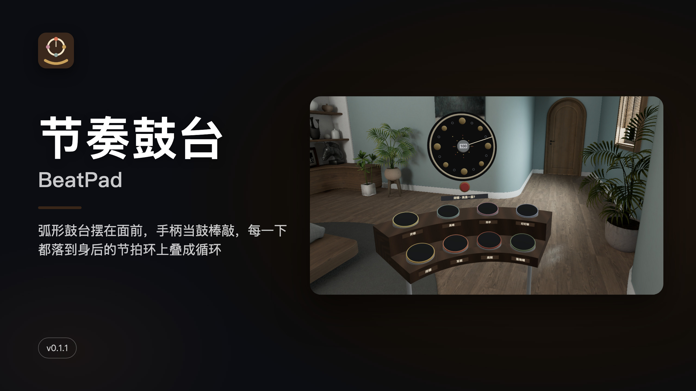
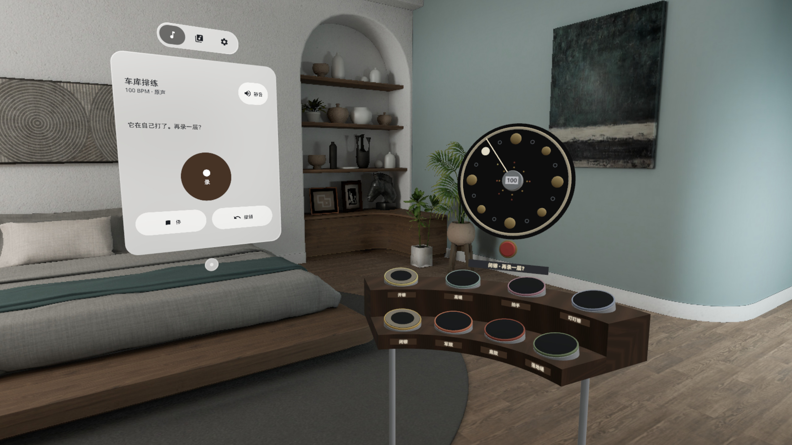
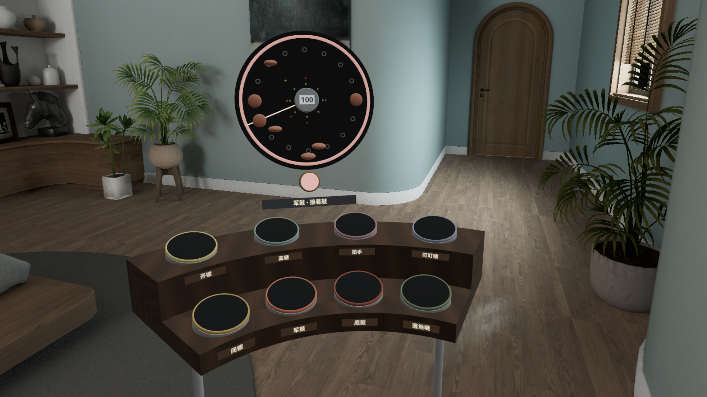
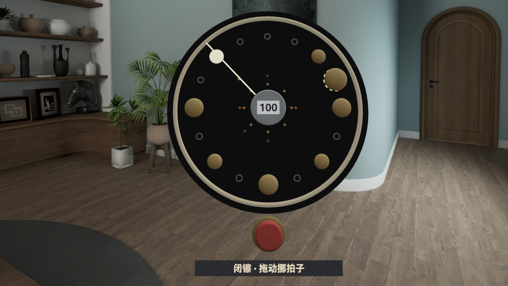
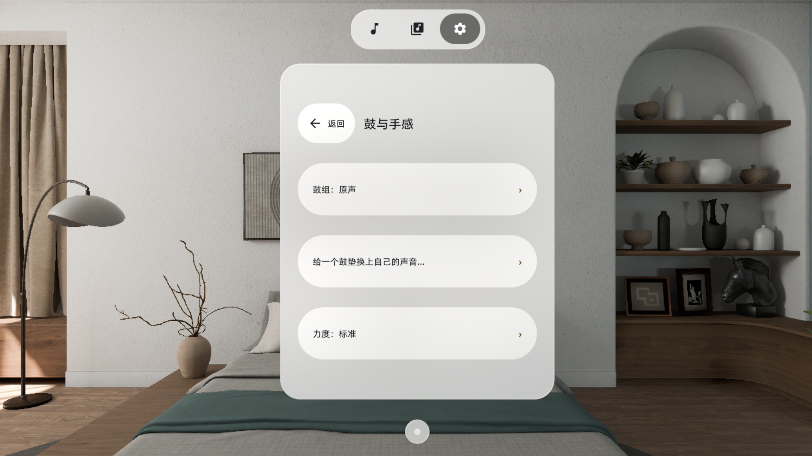
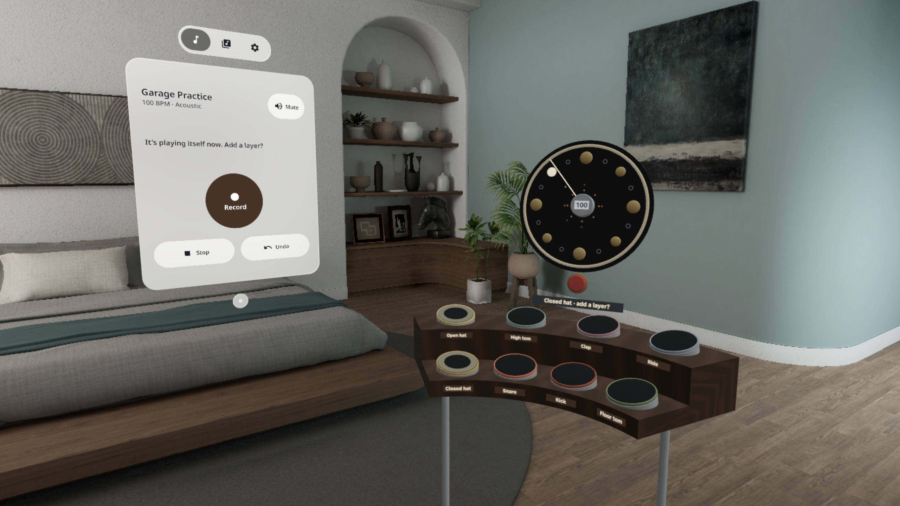
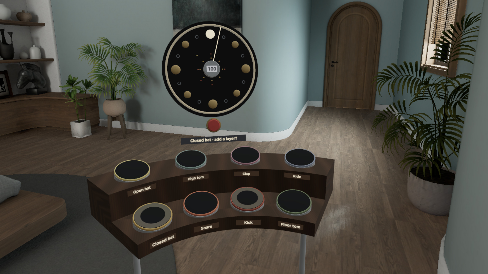
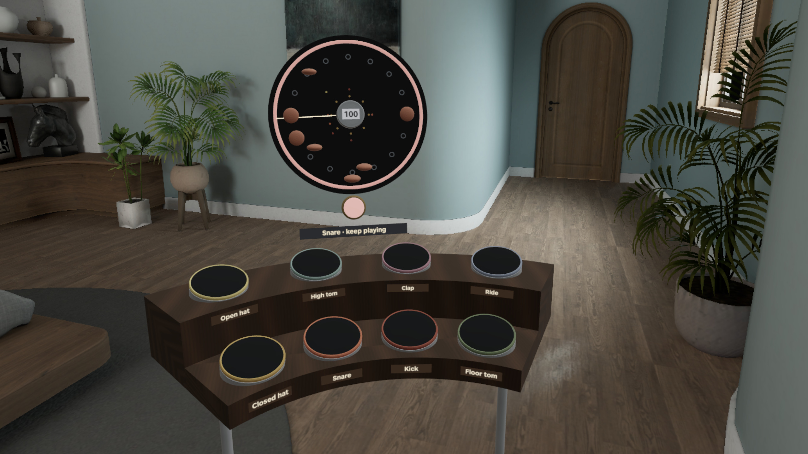
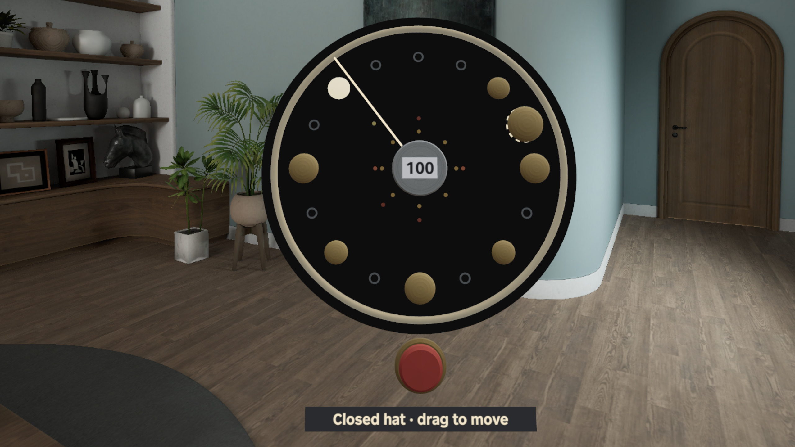
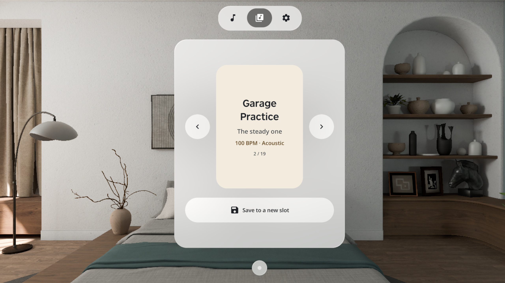

# 节奏鼓台 BeatPad



[中文](#中文) · [English](#english)

## 中文

一张胡桃木弧形鼓台摆在你面前，8 个鼓垫两排排开。拿手柄当鼓棒敲下去，挥得越快声音越响；鼓台后面立着一圈节拍环，你录下的每一下都会落成环上的一颗小石子，一圈圈叠成你自己的循环。

PICO OS 6 混合现实应用（PICO Spatial SDK 6.1.9）：Full Space 透视场景里放鼓台和节拍环，一个系统窗口放演奏 / 节拍库 / 设置。

### 截图

| | |
|---|---|
|  演奏中：左边是控制面板，右边是鼓台和身后的节拍环 |  从演奏位置看：两排 8 个鼓垫，环上是闭镲这一轨的 8 颗石子 |
|  录制中：刚敲的军鼓化成石子飞到环上 |  拖石子：把一拍拖到别的位置，虚线圈是要落的空格 |
|  节拍库：6 段现成节拍和 12 个「我的」空位 |  鼓与手感：换鼓组、给鼓垫换自己的声音、调力度 |

截图和演示视频在模拟器上拍，3D 敲击由调试广播驱动，**非真实手势录像**。

### 怎么玩

- 三种打法同时开着，不用选：手柄当鼓棒敲（挥速 = 力度）；开着手部追踪就直接用手拍；或者用射线 / 眼动 + 捏合点鼓垫
- 按「录」：先听四声嗒的预备拍，第五下开始录；录完自己循环，可以再录一层叠上去，「撤销」一次退一层
- 节拍环上的石子直接拖到别的拍子上，拖出环就删掉；中间旋钮改速度（60–160 BPM，80 / 100 / 120 吸附）
- 3 套鼓（原声 / 电子 / 手鼓）、6 段现成节拍、12 个「我的」空位；任意鼓垫可以换成你自己的声音文件
- 鼓台可以拖着挪、左右转，或者一键「回到面前」；设置首屏有「叫回面前」和「退出应用」
- 中英双语，全部本机运行，不联网、不需要账号、不要麦克风和相机

### 安装

Release 里的 APK 是 `assembleRelease` 出的未签名包（上架用），自己装请先签名，或从源码构建 debug 包：

```bash
export JAVA_HOME=~/.pico/primer-cli/jdk/jdk-21.0.13+9/Contents/Home   # 任意 JDK 17+
./gradlew assembleDebug
adb install -r app/build/outputs/apk/debug/app-debug.apk
pico-cli app launch io.embodit.beatpad
```

v0.1.2：去掉应用自己画的手柄射线，只留系统射线；鼓棒伸到鼓面上开始敲时，系统射线和手柄指示也一起隐藏，只看到鼓棒，抬手离开鼓台恢复。版本记录见 [CHANGELOG.md](CHANGELOG.md)。

模拟器 QA 三轮通过（模拟器没有手柄，敲鼓时隐藏射线只能靠单测和代码核对），还要在头显上核对：敲鼓时只见鼓棒没有射线、抬手指向窗口时恰好一条射线、敲鼓时手和手柄仍然可见；以及敲击到出声的延迟（目标 < 30 ms，`adb logcat -s BeatPad:V | grep -E 'LATENCY|STRIKE'`）、三种打法的手感、预备拍时节拍环的颜色。

## English

A curved walnut drum deck stands in front of you with 8 pads in two rows. Use your controllers as drumsticks: the faster you swing, the louder the hit. Behind the deck stands a beat ring, and every hit you record drops onto it as a small stone, layer after layer, until you have your own loop.

A PICO OS 6 mixed-reality app (PICO Spatial SDK 6.1.9): the deck and the ring live in a Full Space passthrough scene, one system window holds Play / Beats / Settings.

### Screenshots

| | |
|---|---|
|  Playing: the control window on the left, the deck and its beat ring on the right |  From where you play: 8 pads in two rows, the ring shows the 8 closed-hat stones |
|  Recording: the snare you just hit flies onto the ring as stones |  Drag a stone to another step; the dashed circle shows where it lands |
|  Beats: 6 ready-made grooves and 12 slots of your own |  Drums & feel: change kit, put your own sound on a pad, set the touch |

Screenshots and the demo video were taken on the emulator; 3D hits were driven by debug broadcasts, **not a recording of real hand input**.

### How it plays

- Three ways to hit, all on at once: controllers as sticks (swing speed = velocity), bare hands when hand tracking is on, or point with the ray / gaze + pinch
- Press Record: four count-in clicks, recording starts on the fifth; it loops right away, record another layer on top, Undo takes one layer off
- Drag stones on the ring to another step, drag them off to delete; turn the knob in the middle for tempo (60–160 BPM, snaps at 80 / 100 / 120)
- 3 kits (Acoustic / Electronic / Hand drums), 6 grooves, 12 slots of your own; put your own sound file on any pad
- Move the deck by dragging, turn it, or bring it back in front; Bring back and Quit app sit on the first Settings page
- Chinese and English, fully offline, no account, no microphone or camera

### Install

The APK on the Release is the unsigned `assembleRelease` build (for store upload). To sideload, sign it first or build a debug APK from source:

```bash
export JAVA_HOME=~/.pico/primer-cli/jdk/jdk-21.0.13+9/Contents/Home   # any JDK 17+
./gradlew assembleDebug
adb install -r app/build/outputs/apk/debug/app-debug.apk
pico-cli app launch io.embodit.beatpad
```

v0.1.2: the app no longer draws its own controller ray, only the system ray is used; when a stick reaches the pad faces to drum, the system ray and controller pointer are hidden too, so you only see the sticks, and they come back when you lift away from the deck. See [CHANGELOG.md](CHANGELOG.md).

Passed three rounds of emulator QA (the emulator has no controllers, so hiding the ray while drumming is covered by unit tests and code review only). Still to check on a headset: only the sticks and no ray while drumming, exactly one ray when you point at the window, hands and controllers still visible while drumming; plus hit-to-sound latency (target < 30 ms, `adb logcat -s BeatPad:V | grep -E 'LATENCY|STRIKE'`), how the three ways to hit feel, and the ring colour during the count-in.

## Credits

Drum sounds: 48 CC0 recordings from [freesound.org](https://freesound.org) (one line per file with author and link in [docs/sound-sources.md](docs/sound-sources.md)). Metronome and UI ticks: [Kenney](https://kenney.nl) impact / interface sounds (CC0). Font: Noto Sans (SIL OFL 1.1). Started from Spatial Calculator (Stage + one window + level gate).
